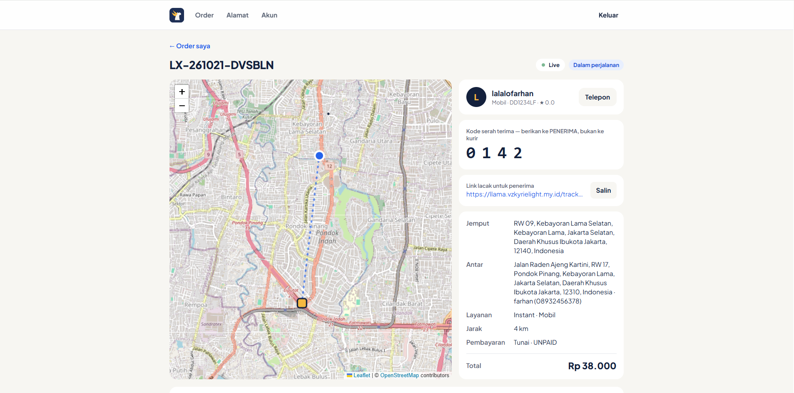
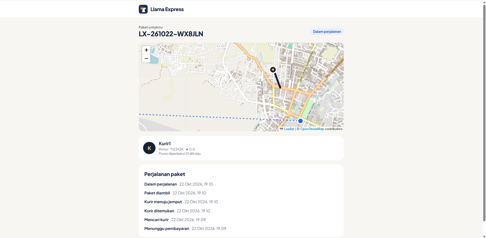
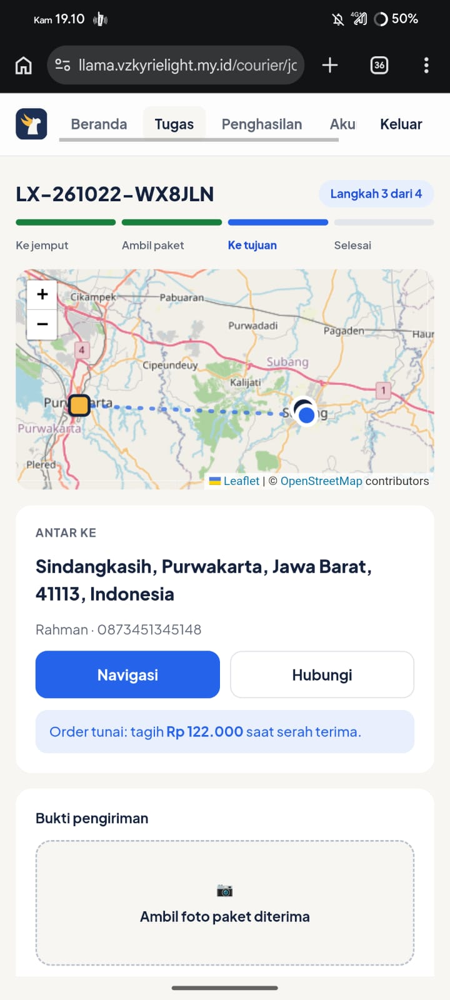
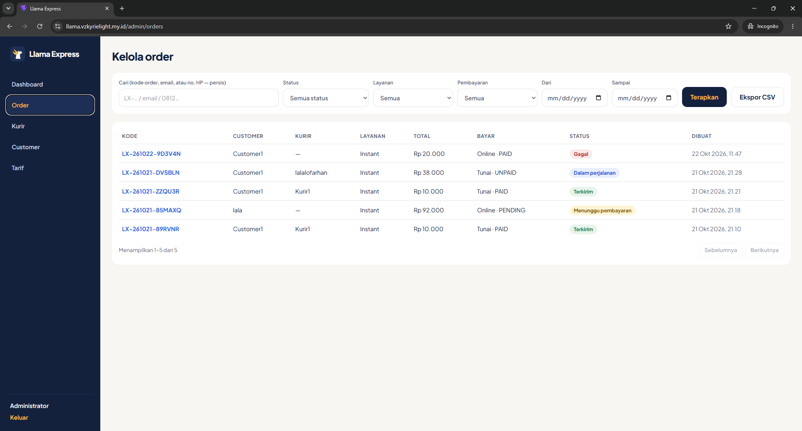
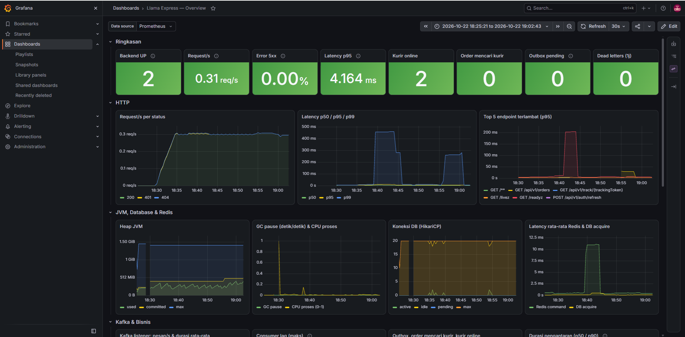
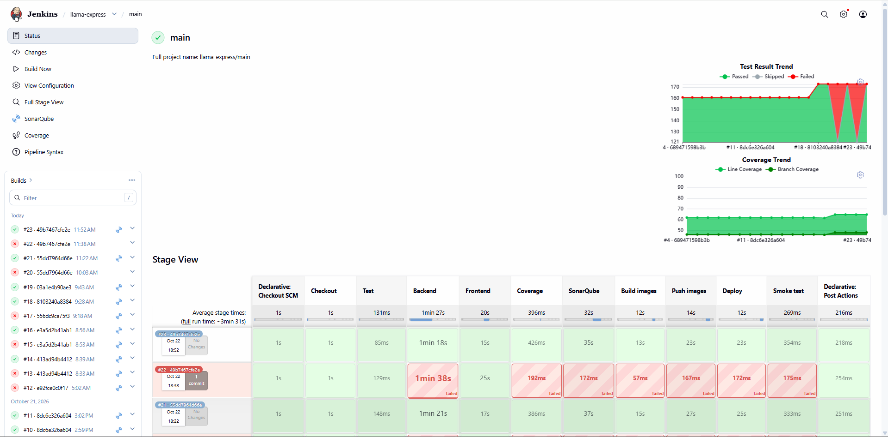
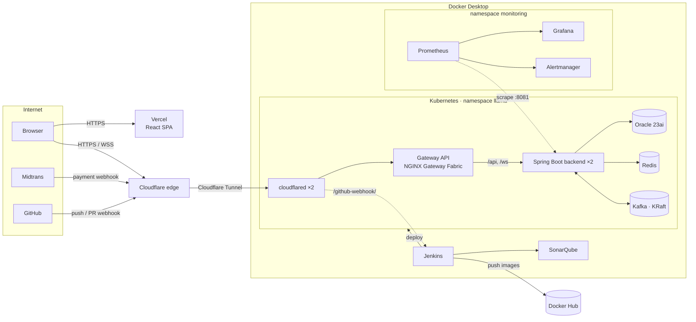

# Llama Express

A real-time, on-demand courier platform in the spirit of GrabExpress: customers book a delivery on a map, nearby couriers get dispatched automatically, and everyone follows the courier live until the package arrives.

The project covers the whole lifecycle: an event-driven Spring Boot backend, a React frontend, and the infrastructure around them (Kubernetes, CI/CD, monitoring, public exposure). I built it to practise the engineering decisions that production systems need, not only the features.

> **Live demo:** https://llama.vzkyrielight.my.id
> The frontend is hosted on Vercel. The API runs on my own machine (Kubernetes on Docker Desktop) and is published through a Cloudflare Tunnel, so **the API is only reachable while that machine is on.** If login fails, the backend is probably offline.

| Role     | Email                   | Password                   |
| -------- | ----------------------- | -------------------------- |
| Customer | `<demo-customer-email>` | `<demo-customer-password>` |
| Courier  | `<demo-courier-email>`  | `<demo-courier-password>`  |

Payments use the **Midtrans sandbox**. No real money is involved; pay a Virtual Account order with the [Midtrans sandbox simulator](https://simulator.sandbox.midtrans.com).

---

## Screenshots

| Booking a delivery                               | Live tracking                                       |
| ------------------------------------------------ | --------------------------------------------------- |
|  |  |

| Courier job                                 | Admin dashboard                                     |
| ------------------------------------------- | --------------------------------------------------- |
|  |  |

| Monitoring (Grafana)                         | CI/CD (Jenkins)                              |
| -------------------------------------------- | -------------------------------------------- |
|  |  |

---

## Features

**Customer**

- Register, manage saved addresses, and pick pickup/drop-off points on a map (OpenStreetMap + Nominatim reverse geocoding)
- Instant price quote (service type, vehicle, weight), then place the order
- Pay by cash or online through Midtrans Snap
- Follow the order live: status changes and the courier's position stream over WebSocket
- Share a public tracking link (token-based, no login), cancel an order, and rate the courier

**Courier**

- Register as a courier (requires admin verification), go online/offline
- Receive delivery offers automatically; accept or reject them
- Step through the job (start pickup → picked up → deliver), upload a proof-of-delivery photo, see earnings
- Location is reported from the browser while a job is active

**Admin**

- Dashboard summary, order list with detail, cancellation and export
- Manage tariffs, suspend/activate users, verify or reject couriers

---

## Architecture



### Request and event flow

1. The frontend calls the REST API (`/api/v1/...`) with a short-lived JWT access token and keeps a rotating refresh token.
2. State changes (order created, status changed) are written to the database **and** to an outbox table in the same transaction. A scheduled publisher moves outbox rows to Kafka.
3. Kafka consumers react to events: the dispatcher offers the order to couriers, location history is persisted, and a WebSocket bridge pushes updates to browsers over STOMP.

### Design decisions worth reading

| Problem                                                                   | Decision                                                                                                                                                                                                       |
| ------------------------------------------------------------------------- | -------------------------------------------------------------------------------------------------------------------------------------------------------------------------------------------------------------- |
| Losing events when the DB commit and the Kafka publish disagree           | **Transactional outbox** + scheduled publisher                                                                                                                                                                 |
| Running several backend pods with an in-memory STOMP broker               | Each pod consumes status/location topics with its **own consumer group** (fan-out) and forwards to its local WebSocket clients. Those groups never commit offsets, so Kafka discards them when a pod goes away |
| Scheduled jobs running twice when scaled out                              | **ShedLock** (JDBC) around the outbox publisher, dispatch sweeper and housekeeping                                                                                                                             |
| Missed real-time events during a reconnect (e.g. while a pod is replaced) | The client re-subscribes first, then **refetches from REST**; WebSocket is a notification channel, REST is the source of truth                                                                                 |
| Race conditions on courier assignment, tariffs, payments                  | Pessimistic row locks                                                                                                                                                                                          |
| Rate limiting that works across pods                                      | Counters in **Redis**                                                                                                                                                                                          |
| Forged payment notifications                                              | Midtrans `signature_key` (SHA-512) verification **plus** a status re-check against the Midtrans API                                                                                                            |
| Exposing a laptop-hosted API safely                                       | Cloudflare Tunnel (outbound only, no open ports); only `/api` and `/ws` are routed; actuator lives on a separate port that the gateway never routes to                                                         |
| Triggering CI from GitHub without exposing Jenkins                        | Only `/github-webhook/` is published, and payloads are verified with an **HMAC** shared secret                                                                                                                 |
| XSS stealing tokens                                                       | Enforced **Content-Security-Policy** and security headers on Vercel                                                                                                                                            |

---

## Tech stack

| Layer         | Technologies                                                                                                                                                         |
| ------------- | -------------------------------------------------------------------------------------------------------------------------------------------------------------------- |
| Backend       | Java 25, Spring Boot 4.1 (Web MVC, Security / OAuth2 resource server with JWT, Data JPA, WebSocket/STOMP, Kafka, Data Redis, Actuator), Flyway, ShedLock, Micrometer |
| Data          | Oracle Database 23ai Free, Redis, Apache Kafka 4.1 (KRaft)                                                                                                           |
| Frontend      | React 19, TypeScript, Vite, React Compiler, Tailwind CSS 4, React Router, TanStack Query, React Hook Form + Zod, Leaflet, STOMP.js                                   |
| Integrations  | Midtrans Snap (sandbox), Cloudinary (proof photos), OpenStreetMap tiles + Nominatim                                                                                  |
| Testing       | JUnit 5 + Testcontainers (Oracle, Kafka, Redis); Jest + React Testing Library + MSW; Postman/Newman collection                                                       |
| Platform      | Docker, Kubernetes (Docker Desktop), Kustomize, Gateway API (NGINX Gateway Fabric), Helm                                                                             |
| CI/CD         | Jenkins (multibranch, GitHub webhooks, PR status checks), SonarQube quality gate, Docker Hub, automated rollout with rollback and smoke test, Vercel                 |
| Observability | kube-prometheus-stack (Prometheus, Alertmanager, Grafana), custom dashboard and alert rules                                                                          |
| Edge          | Cloudflare (DNS, TLS, Tunnel)                                                                                                                                        |

---

## Repository layout

```
Backend/backend/        Spring Boot application
  src/main/java/...     modules: auth, user, address, order, dispatch, courier,
                        delivery, tracking, payment, rating, admin, common
  src/main/resources/   application.yml, Flyway migrations (db/migration)
  postman/              Postman collection + Newman runner
Frontend/frontend/      React application (src/features/* per domain), vercel.json
Infra/
  docker-compose.yml    local tooling and dev dependencies (profiles)
  jenkins/              Jenkins image (JDK 25, Node, Docker CLI, kubectl, plugins)
  k8s/base/             Kustomize base: oracle, kafka, redis, backend, frontend,
                        gateway, cloudflared, network policies, CI service account
  k8s/overlays/local/   local overlay (images, secret generators)
  k8s/monitoring/       Helm values, ServiceMonitor, alert rules, Grafana dashboard
  prometheus/ grafana/  configuration for the docker-compose monitoring profile
Jenkinsfile             CI/CD pipeline
docs/RUNBOOK.md         operating guide (startup, checks, incidents)
```

---

## Running locally

### Prerequisites

- Docker Desktop with Kubernetes enabled (kubeadm), WSL2 memory ≥ 16 GB recommended
- JDK 25 and Node.js 22+ (npm 11) for development outside containers
- `kubectl` and `helm`

### Option A: develop against docker-compose dependencies

```bash
cd Infra
# create Infra/.env with: MIDTRANS_CLIENT_KEY, ORACLE_SYS_PASSWORD, DB_USERNAME, DB_PASSWORD
docker compose --profile dev up -d          # oracle, kafka, kafka-ui, redis

cd ../Backend/backend
./mvnw spring-boot:run          # reads an optional .env in this folder (DB_USERNAME, DB_PASSWORD, JWT_SECRET, MIDTRANS_*, CLOUDINARY_URL, ...)

cd ../../Frontend/frontend
cp .env.example .env.development.local     # VITE_API_BASE_URL=http://localhost:8080, VITE_MIDTRANS_CLIENT_KEY=...
npm ci && npm run dev           # http://localhost:5173
```

### Option B: the full stack on Kubernetes

```bash
cd Infra
# 1. secrets (git-ignored): k8s/overlays/local/secrets/{oracle.env, backend.env, cloudflared.token}
# 2. apply the application
kubectl apply -k k8s/overlays/local
# 3. monitoring
helm repo add prometheus-community https://prometheus-community.github.io/helm-charts
kubectl apply -f k8s/monitoring/namespace.yaml
helm upgrade --install kps prometheus-community/kube-prometheus-stack \
  --version 92.11.0 -n monitoring -f k8s/monitoring/values-local.yaml
kubectl apply -k k8s/monitoring
```

The app is then served through the gateway at `http://localhost`. See [`docs/RUNBOOK.md`](docs/RUNBOOK.md) for secrets, the Grafana admin secret, and day-to-day operations.

> `.env` files and `k8s/overlays/*/secrets/` are git-ignored. Never commit them.

---

## Testing

```bash
# backend: unit + integration tests (Testcontainers starts Oracle, Kafka and Redis)
cd Backend/backend && ./mvnw verify

# frontend: type check, tests with coverage, lint
cd Frontend/frontend && npx tsc -b && npm run test:ci && npm run lint
```

An API collection for Postman/Newman lives in `Backend/backend/postman/`.

---

## CI/CD

Every push and pull request triggers Jenkins through a GitHub webhook, and the result is reported back to the pull request as a status check.

```
Checkout → Test (backend ∥ frontend) → Coverage → SonarQube quality gate → Build images
        → [main only] Push to Docker Hub → Deploy to Kubernetes → Smoke test
```

- Images are tagged with the 12-character commit SHA (immutable) plus a moving `main` tag.
- Deploy uses a least-privilege service account that may only patch the backend and frontend Deployments.
- If the rollout or the smoke test fails, the pipeline restores the previously running images automatically.
- Vercel builds the frontend from `main`; feature branches get preview deployments.

Branching: `feat/*` → `dev` → `main`, each through a pull request.

---

## Observability

- Prometheus scrapes the backend actuator on a dedicated management port (`:8081`), kubelet resource metrics, kube-state-metrics and node-exporter.
- The **Llama Express — Overview** dashboard covers HTTP rate/errors/latency (p50/p95/p99), JVM, database pool, Redis, Kafka listeners and lag, business gauges (couriers online, orders searching, outbox backlog) and container CPU/memory.
- Alert rules include backend down, 5xx ratio, slow p95, heap pressure, DB pool exhaustion, container memory near limit, outbox backlog, dead letters, consumer lag and "orders waiting with no courier online".

---

## Known limitations

- The API depends on a single laptop, so availability follows that machine.
- Kubernetes runs on one node; topology spread and NetworkPolicies are written for a real cluster but are not enforced by Docker Desktop's default networking.
- Sandbox payments only.
